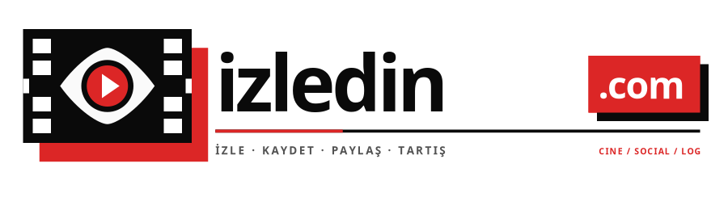

<div align="center">
  

  <h1>izledin.com</h1>
  <p><strong>Gece gösterimi sinema kulübü, 35mm daktilo günlüğü ve izdaş keşif radarı.</strong></p>

  <p>
    <a href="https://www.izledin.com">Canlı Siteyi Ziyaret Et →</a> •
    <a href="#hakkında">Hakkında</a> •
    <a href="#öne-çıkan-özellikler">Özellikler</a> •
    <a href="#mimari--teknoloji-yığını">Mimari</a> •
    <a href="#yerel-kurulum">Kurulum</a> •
    <a href="#lisans">Lisans</a>
  </p>

  <p>
    
    
    
    
    
    
  </p>
</div>

---

## Hakkında

Geleneksel film takip platformlarında herkes bir izleme listesi tutuyor; ancak aynı sahnede donup kaldığınız, aynı kült yönetmenin filmlerini aradığınız insanlarla tanışabileceğiniz organik bir alan yok.

**izledin.com**, film günlüğü tutmayı 35mm analog fanzin estetiğinde bir gece gösterimi sinema kulübüne dönüştürüyor. Platformun merkezinde, izleme geçmişinizi, puanlarınızı ve tat tercihlerinizi analiz ederek sizinle aynı sinema frekansındaki insanları buluşturan **İzdaş Radarı** yer alıyor.

---

## Öne Çıkan Özellikler

* **PERDE (Matching-First Deste):** Ana sayfa klasik bir katalog vitrini değil, doğrudan sinema zevkinizi keşfettiğiniz bir başlık ve insan destesidir. Kaydırdıkça sinema frekansınız şekillenir.
* **İzdaş Radarı & Uyum:** PostgreSQL üzerinde çalışan çok boyutlu `calculate_cinephile_matches` algoritması; tür benzerliği, yayın servisleri ve ortak beğenilen yapımların kesişimiyle gerçek sinefilleri buluşturur. Sahte profil veya bot bulunmaz.
* **35mm Daktilo Günlüğü:** İzlediğiniz filmleri puanlayın, fanzin tipografisiyle incelemelerinizi daktiloya dökün ve topluluk akışında tartışın.
* **Bilet & Ortak Seans:** İlginizi çeken izdaşlara öne çıkan mesaj isteği (Bilet) gönderin. Eşleştiğinizde sohbet içi gerçek zamanlı "Birlikte İzleyeceklerimiz" listesi oluşturun.
* **0ms Hibrit Sinema Kataloğu:** Yerel ~2.000 kült film veritabanı ile anlık bellek araması, eksik yapımlarda ise OMDB köprüsü üzerinden anlık tamamlama.
* **Güvenlik & İzdaş Güvencesi:** Spam önleyici mesaj istekleri, doğum tarihini dışarıya sızdırmayan güvenlik katmanı, RLS ile kilitli veritabanı ve opt-in haftalık radar bülteni.

---

## Mimari & Teknoloji Yığını

| Alan | Araçlar & Kütüphaneler |
| :--- | :--- |
| **Frontend Framework** | [Next.js 16](https://nextjs.org/) (App Router, Turbopack, React Server Components) |
| **Kullanıcı Arayüzü** | [React 19](https://react.dev/), [Tailwind CSS v4](https://tailwindcss.com/) (Neobrutalist 35mm Fanzin Tasarım Sistemi) |
| **Veritabanı & Kimlik** | [Supabase](https://supabase.com/) (PostgreSQL 17, GoTrue OAuth, Row Level Security, RPCs) |
| **Gerçek Zamanlı İletişim** | [Supabase Realtime](https://supabase.com/realtime) (WebSockets ile mesajlaşma ve ortak seans) |
| **Film & Medya Verisi** | Yerel Statik Katalog + OMDB REST API |
| **E-posta & Görevler** | [Resend](https://resend.com/) + Vercel Cron (`/api/cron/digest`) |
| **Tip Güvenliği** | Katı TypeScript ve otomatik üretilen veritabanı şema tipleri |

---

## Yerel Kurulum

Projeyi yerel ortamınızda çalıştırmak için aşağıdaki adımları izleyin:

### 1. Depoyu klonlayın ve bağımlılıkları kurun

```bash
git clone https://github.com/foxx8n/izledin.com.git
cd izledin.com
npm install
```

### 2. Ortam değişkenlerini yapılandırın

`.env.example` dosyasını kopyalayarak `.env.local` oluşturun:

```bash
cp .env.example .env.local
```

Gerekli anahtarları tanımlayın:
```env
# Supabase
NEXT_PUBLIC_SUPABASE_URL=https://your-project.supabase.co
NEXT_PUBLIC_SUPABASE_ANON_KEY=your-anon-key
SUPABASE_SERVICE_ROLE_KEY=your-service-role-key

# OMDB API (Film künyeleri ve arama için)
OMDB_API_KEY=your_omdb_key

# Opsiyonel: E-posta ve Cron
RESEND_API_KEY=re_your_key
CRON_SECRET=your_cron_secret

# Opsiyonel: Yönetici paneli erişimi
NEXT_PUBLIC_ADMIN_EMAILS=your-email@example.com
```

### 3. Geliştirme sunucusunu başlatın

```bash
npm run dev
```

Tarayıcınızda [http://localhost:3000](http://localhost:3000) adresine gidin.

---

## Veritabanı Yapısı

Veritabanı şeması ve migration dosyaları `supabase/` dizininde yer almaktadır:
- `profiles`: Kullanıcı profilleri, zevk DNA'sı, gizlilik ayarları
- `watch_logs`: Bilinçli günlük kayıtları ve incelemeler
- `movie_mate_matches`: İzdaş eşleşme durum makinesi (pending, matched, passed, blocked)
- `title_swipes`: Deste kaydırmaları ve tat vektörleri
- `messages`: Eşleşmeler arası güvenli mesajlaşma
- `watch_together_items`: Eşleşen kullanıcıların ortak izleme listesi

Tüm tablolarda Row Level Security (RLS) devrededir; hassas kolonlar doğrudan istemci erişimine kapalıdır.

---

## Lisans

Bu proje **Source-Available (Kaynak Açık, Telif Hakları Saklı)** lisansıyla sunulmaktadır.
Detaylı yasal şartlar için [LICENSE](LICENSE) dosyasına göz atabilirsiniz.

* Kodu kişisel kullanım, öğrenme, araştırma ve katkı sağlamak amacıyla inceleyebilir, forklayabilir ve geliştirebilirsiniz.
* `izledin.com` markasını, logosunu, fanzin tasarım kimliğini veya platform kodunu ticari bir SaaS / rakip hizmet olarak yayınlayamazsınız.

© 2026 **izledin.com**. Tüm Hakları Saklıdır.
